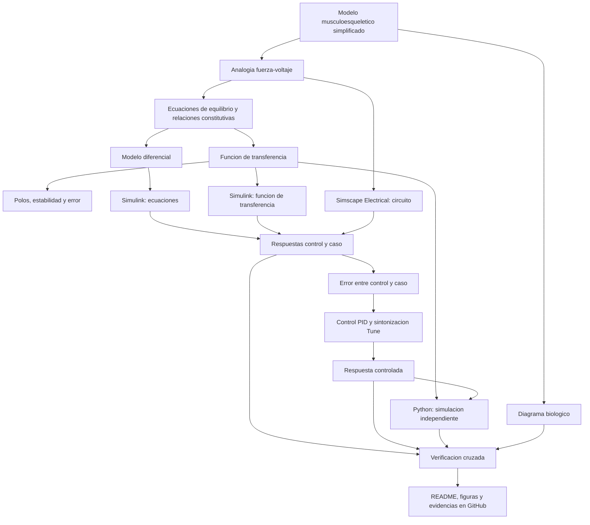

[](https://matlab.mathworks.com/open/github/v1?repo=23212806-debug/MSFP3)

# Práctica 3 — Modelado y control del sistema musculoesquelético

Repositorio académico de la asignatura **Modelado de Sistemas Fisiológicos**, correspondiente al programa de **Ingeniería Biomédica** del Tecnológico Nacional de México / Instituto Tecnológico de Tijuana. Esta práctica integra modelado matemático, analogías eléctricas de sistemas fisiológicos, análisis temporal y de estabilidad, diseño de controladores PID y verificación mediante simulación computacional.

El caso de estudio representa el **comportamiento mecánico simplificado del sistema musculoesquelético** mediante un conjunto de elementos contráctiles, elásticos y viscosos. Se busca reproducir y comparar la respuesta de un individuo sano (**control**) frente a un caso simulado de **atrofia muscular**, modificando la resistencia equivalente del modelo y proponiendo una estrategia de control *in silico* para reducir las diferencias entre ambas respuestas.

**Docente:** Dr. Paul Antonio Valle Trujillo  
**Correo:** paul.valle@tectijuana.edu.mx  
**Departamento:** Ingeniería Eléctrica y Electrónica  
**Institución:** Tecnológico Nacional de México / Instituto Tecnológico de Tijuana  
**Asignatura:** Modelado de Sistemas Fisiológicos  
**Programa:** Ingeniería Biomédica  
**Estudiante:** Martínez Lozano Pedro Damián · 23212806 · 23212806@tectijuana.edu.mx

**Repositorio de la asignatura:** https://github.com/DrPaulValle/MSF-IBF1020  
**Sede:** Blvd. Alberto Limón Padilla s/n, Tijuana, C. P. 22454, B. C., México.

---

<a id="contenido"></a>
## Contenido

1. [Resumen](#resumen)
2. [Competencia y objetivos](#objetivos)
3. [Relación con el temario](#temario)
4. [Modelo físico y analogía eléctrica](#analogia)
5. [Formulación matemática](#modelo)
6. [Análisis temporal y de estabilidad](#analisis)
7. [Señales de entrada y condiciones de simulación](#senales)
8. [Implementación en MATLAB, Simulink y Simscape](#matlab)
9. [Control en lazo cerrado y sintonización PID](#pid)
10. [Reproducción en Python](#python)
11. [Diagrama biológico e interpretación fisiológica](#biologico)
12. [Resultados y verificación cruzada](#resultados)
13. [Flujo de trabajo](#flujo)
14. [Actividades del estudiante](#actividades)
15. [Estructura del repositorio](#estructura)
16. [Requisitos](#requisitos)
17. [Reproducibilidad y entregables](#reproducibilidad)
18. [Referencias](#referencias)

---

<a id="resumen"></a>
## Resumen

La práctica tiene como propósito **reproducir un procedimiento de modelado, análisis, simulación y control** aplicado a un compartimento musculoesquelético. El modelo combina la fuerza generada por un elemento contráctil activo, un amortiguador viscoso y dos elementos elásticos. Mediante la **analogía fuerza–voltaje**, sus propiedades mecánicas se representan con resistencias y capacitancias eléctricas.

Se analizan dos condiciones: un individuo sano (**control**) y un caso simulado de atrofia muscular (**caso**). La diferencia entre ambos se introduce modificando la resistencia equivalente $R$, y se compara su respuesta a una entrada de fuerza. Posteriormente se incorpora un **controlador PID con retroalimentación** y se estudia si es posible reducir el error entre la respuesta del caso y la respuesta de referencia del individuo sano.

Las representaciones a verificar son el modelo matemático, la función de transferencia en Simulink, el circuito en Simscape Electrical y su reproducción mediante Python. Esta práctica se desarrolla **exclusivamente mediante experimentación *in silico***: el controlador constituye una estrategia académica de simulación y **no una intervención terapéutica**.

**Palabras clave:** sistema musculoesquelético; atrofia muscular; analogía fuerza–voltaje; resistencia viscosa; compliancia; función de transferencia; controlador PID; MATLAB; Simulink; Simscape Electrical; Python.

[Volver al contenido](#contenido)

---

<a id="objetivos"></a>
## Competencia y objetivos

### Competencia a desarrollar

Modelizar sistemas fisiológicos mediante analogías entre sistemas físicos, ecuaciones diferenciales y funciones de transferencia para analizar su comportamiento dinámico y diseñar estrategias de control mediante técnicas de control clásico. En particular, comparar la respuesta de un individuo sano con un caso simulado de atrofia muscular y evaluar una estrategia de control *in silico* orientada a reducir las diferencias entre ambas respuestas.

### Objetivo general

Modelar y simular un sistema musculoesquelético simplificado mediante su representación mecánica y electroequivalente, identificar las diferencias dinámicas entre las condiciones de control y caso, y evaluar una estrategia de control PID utilizando MATLAB/Simulink y Python.

### Objetivos específicos

- Identificar la fuerza aplicada, la fuerza contráctil, la amortiguación viscosa, las compliancias y los desplazamientos del modelo.
- Construir la analogía fuerza–voltaje y verificar las conexiones eléctricas equivalentes.
- Formular las ecuaciones de equilibrio y obtener la función de transferencia del sistema.
- Analizar el error en estado estacionario, los polos y la estabilidad para control y caso.
- Implementar el sistema por ecuaciones, función de transferencia y Simscape Electrical.
- Comparar las respuestas ante una entrada impulso unitario en $t\in[0,10]$ s.
- Incorporar un controlador PID y registrar las ganancias $k_P$, $k_I$ y $k_D$ obtenidas con **Tune**.
- Reproducir las respuestas en Python y contrastarlas con las de MATLAB/Simulink.
- Relacionar los elementos del modelo con sus estructuras musculoesqueléticas y documentar los resultados en GitHub.

[Volver al contenido](#contenido)

---

<a id="temario"></a>
## Relación con el temario

La práctica retoma conceptos de tres áreas de la asignatura **Modelado de Sistemas Fisiológicos (IBF-1020)**:

| Unidad | Área | Contenidos aplicados |
|---|---|---|
| I | Sistemas de control retroalimentados | Comparación de respuestas control/caso, definición del error y retroalimentación |
| II | Modelado matemático | Analogía fuerza–voltaje, relaciones constitutivas, equilibrio mecánico y función de transferencia |
| III | Controladores | Control PID, sintonización de ganancias y análisis de respuesta en lazo cerrado |

El enfoque integra **Ingeniería de Control, Electrónica, Ciencias de la Computación y Fisiología Musculoesquelética**, vinculando propiedades de tejidos y tendones con un modelo dinámico simplificado.

[Volver al contenido](#contenido)

---

<a id="analogia"></a>
## Modelo físico y analogía eléctrica

El modelo mecánico presentado en la **Figura 5.3** del instructivo contiene un elemento contráctil que genera la fuerza $F_0(t)$, un amortiguador viscoso $R$ y dos elementos elásticos identificados mediante las compliancias $C_p$ y $C_s$. La fuerza transmitida al exterior es $F(t)$.

La fuerza activa se relaciona con la aplicada mediante:

$$F_0(t)=\alpha F(t),\qquad 0<\alpha<1.$$

El desplazamiento del amortiguador es $x(t)-x_1(t)$, por lo que la velocidad relativa es:

$$\frac{d}{dt}\big[x(t)-x_1(t)\big].$$

| Símbolo mecánico | Equivalente eléctrico | Interpretación fisiológica |
|---|---|---|
| $F(t)$ | Voltaje $V(t)$ | Fuerza transmitida por el sistema |
| $F_0(t)$ | Fuente dependiente de voltaje | Fuerza del elemento contráctil activo |
| $\dot x(t)$ | Corriente $I(t)$ | Velocidad mecánica |
| $x(t)$ | Carga $q(t)$ | Desplazamiento |
| $R$ | Resistencia | Amortiguación viscosa inherente al tejido |
| $C_p$ | Capacitancia | Compliancia elástica de la rama paralela |
| $C_s$ | Capacitancia | Compliancia elástica de la rama en serie |
| Masa, si está presente | Inductancia | Inercia mecánica; el esquema básico no incluye masa explícita |

**Regla de conversión del instructivo:** los elementos mecánicos en **paralelo** pueden corresponder a elementos eléctricos en **serie**, y viceversa; la identificación correcta de los desplazamientos y nodos de referencia es indispensable.

### Parámetros de la emulación eléctrica

| Parámetro | Control | Caso | Unidad |
|---|---:|---:|---|
| $F(t)$ | 1 | 1 | V (analogía eléctrica) |
| $\alpha$ | 0.25 | 0.25 | Adimensional |
| $C_s$ | 10 | 10 | $\mu$F |
| $C_p$ | 100 | 100 | $\mu$F |
| $R$ | 100 $\Omega$ | 10 k$\Omega$ | Resistencia eléctrica |

**Corrección de lectura de la tabla:** la fila de $R$ del instructivo indica **100 $\Omega$ para control** y **10 k$\Omega$ para caso**. En el archivo `sistema1.slx` aportado, la función de transferencia incorpora **10 k$\Omega$** en su expresión tanto para el bloque etiquetado *Control* como para el bloque etiquetado *Caso*. Esta discrepancia entre el instructivo y el archivo suministrado debe verificarse al configurar definitivamente las dos condiciones; no se presupone que ambas representan parámetros diferenciados.

> **Alcance de la analogía:** los valores de resistencia y capacitancia corresponden a la emulación eléctrica. La equivalencia entre fuerza, velocidad, desplazamiento y variables eléctricas mantiene la estructura del sistema, pero no implica convertir unidades fisiológicas en unidades eléctricas sin establecer escalas.

[Volver al contenido](#contenido)

---

<a id="modelo"></a>
## Formulación matemática

### 1. Relaciones constitutivas

En la analogía fuerza–voltaje, el amortiguamiento viscoso se expresa mediante una relación proporcional entre fuerza y velocidad relativa, mientras que los elementos de compliancia relacionan el desplazamiento con la fuerza elástica. Las ecuaciones deben establecerse respetando la distribución de ramas de la Figura 5.3.

Para el elemento viscoso:

$$F_R(t)=R\,\frac{d}{dt}\left[x(t)-x_1(t)\right].$$

Para un elemento elástico lineal de compliancia $C$, bajo una convención de signos consistente:

$$x_C(t)=C\,F_C(t),\qquad F_C(t)=\frac{x_C(t)}{C}.$$

El elemento activo satisface $F_0(t)=\alpha F(t)$. Al combinar estas relaciones con el equilibrio de fuerzas de las ramas se obtiene el modelo dinámico equivalente.

### 2. Función de transferencia

El instructivo define la función de transferencia con desplazamiento como salida:

$$G(s)=\frac{X(s)}{F(s)}.$$

Para el **circuito electroequivalente suministrado en el archivo de Simulink**, el bloque `Transfer Fcn` presenta la siguiente función entre las variables eléctricas seleccionadas:

$$\boxed{G_{\mathrm{archivo}}(s)=\frac{R C_s s+(1-\alpha)}{R(C_p+C_s)s+1}.}$$

Esta expresión se transcribe de los coeficientes de los bloques `F(t) Control` y `F(t) Caso` del archivo `.slx`; antes de identificarla sin ambigüedad con $X(s)/F(s)$ se debe comprobar el **punto exacto de medición** empleado en la salida del circuito.

### 3. Coeficientes y orden del modelo

El bloque incluido en el archivo aportado usa:

```matlab
num = [100*10e-6 1-0.25];
den = [100*(100e-6+10e-6) 1];
```

Los coeficientes anteriores son los que aparecen literalmente en el `.slx`. Aunque las etiquetas aluden a **100**, la implementación visible no diferencia todavía las resistencias nominales del control y el caso conforme a la tabla de la práctica. La función representa una **dinámica de primer orden con un cero**. Para reproducir ambas condiciones, verificar y actualizar $R$ según corresponda.

### 4. Representación diferencial asociada a la función de transferencia del archivo

Si $u(t)$ es la entrada del bloque y $y(t)$ su salida, con condiciones iniciales nulas se obtiene:

$$R(C_p+C_s)\,\dot y(t)+y(t)=RC_s\,\dot u(t)+(1-\alpha)u(t).$$

Esta ecuación representa **el bloque de función de transferencia identificado**; su interpretación física depende de cómo se hayan conectado y escalado los puertos en el modelo.

[Volver al contenido](#contenido)

---

<a id="analisis"></a>
## Análisis temporal y de estabilidad

### 1. Error en estado estacionario

Para una entrada escalón de amplitud unitaria aplicada al bloque de función de transferencia, la ganancia estática es:

$$G(0)=1-\alpha=0.75.$$

Si el sistema es estable, su salida final ante esa entrada es $0.75$ en las unidades de la salida del bloque. El error entre **esa entrada y esa salida**, si se comparan directamente, es:

$$e_{ss}=1-G(0)=\alpha=0.25.$$

**Distinción importante:** este cálculo corresponde al seguimiento de una entrada escalón de la función de transferencia mostrada, **no** al error clínico ni al error entre dos pacientes. En el sistema PID del instructivo, el error de comparación es $e(t)=x_{\rm control}(t)-x_{\rm caso}(t)$ y debe evaluarse con las señales efectivamente utilizadas en la retroalimentación.

### 2. Polos y estabilidad

El polo de la función de transferencia indicada es:

$$\boxed{p=-\frac{1}{R(C_p+C_s)}.}$$

Para $R>0$ y $C_p,C_s>0$, el polo se ubica en el semiplano izquierdo del plano complejo, por lo que el bloque de primer orden es **asintóticamente estable**. Un aumento de $R$ acerca el polo al origen y produce una respuesta más lenta para una dinámica equivalente.

### 3. Comparación de condiciones

Con los valores nominales de la tabla del instructivo:

| Magnitud | Control ($R=100\,\Omega$) | Caso ($R=10\,\mathrm{k}\Omega$) |
|---|---:|---:|
| $\tau=R(C_p+C_s)$ | 0.011 s | 1.1 s |
| Polo $p=-1/\tau$ | $-90.91\ \mathrm{s}^{-1}$ | $-0.9091\ \mathrm{s}^{-1}$ |
| Ganancia en DC $G(0)$ | 0.75 | 0.75 |

Los valores de esta tabla son **predicciones analíticas** calculadas de la expresión anterior con los parámetros nominales; no son mediciones de MATLAB. Para contrastarlos con la práctica es necesario que cada bloque de Simulink utilice su respectivo valor de resistencia.

[Volver al contenido](#contenido)

---

<a id="senales"></a>
## Señales de entrada y condiciones de simulación

La práctica solicita analizar la **respuesta al impulso unitario** en el intervalo:

$$0\le t\le10\,\mathrm{s}.$$

| Elemento | Configuración o definición | Propósito |
|---|---|---|
| Entrada $F(t)$ | Impulso unitario | Excitar la respuesta transitoria del sistema |
| Condición control | $R=100\,\Omega$ en la tabla | Representar la respuesta de referencia |
| Condición caso | $R=10\,\mathrm{k}\Omega$ en la tabla | Simular una alteración de amortiguamiento |
| Sistema controlado | Caso con PID | Reducir la diferencia respecto al control |
| Tiempo | 0–10 s | Comparar la evolución temporal |

El cuaderno MATLAB aportado contiene expresamente:

```matlab
clc; clear; close all; warning('off','all')
open_system('sistema1.slx')
parameters.StopTime = '10';
parameters.Solver = 'ode15s';
parameters.MaxStep = '1e-3';
```

El modelo `.slx` incluye un bloque etiquetado `Pulse Generator`. **La forma precisa de ese pulso debe comprobarse en los parámetros del bloque** antes de afirmar que coincide con un impulso de Dirac ideal. Las condiciones iniciales y la configuración concreta del generador deben documentarse junto con las gráficas.

[Volver al contenido](#contenido)

---

<a id="matlab"></a>
## Implementación en MATLAB, Simulink y Simscape

Se contrastan las tres representaciones solicitadas:

| Implementación | Descripción | Aspecto por verificar |
|---|---|---|
| Ecuaciones del sistema, Simulink | Bloques de ecuaciones y relaciones constitutivas | Consistencia con el equilibrio de fuerzas |
| Función de transferencia, Simulink | Bloque dinámico derivado del modelo | Respuesta de control y caso para cada $R$ |
| Circuito equivalente, Simscape Electrical | Resistencias, capacitancias y fuentes controladas | Concordancia de la analogía fuerza–voltaje |

### Archivos y señales identificados en los archivos aportados

En el archivo `sistema1(1).slx` aparecen los subsistemas **Control** y **Caso**, componentes de Simscape, bloques de función de transferencia y un bloque `PID Controller`. Los bloques `To Workspace` registran las señales:

1. **`F`**: señal de entrada $F(t)$.
2. **`Fsx`**: respuesta del control.
3. **`Fsy`**: respuesta del caso.
4. **`PID`**: señal correspondiente al tratamiento/controlador.

El cuaderno `Martinez23212806(2).mlx` ejecuta:

```matlab
x1 = sim('sistema1.slx',parameters);
plotsignals(x1.t,x1.F,x1.Fsx,x1.Fsy,x1.PID)
```

Para reproducir la práctica, el archivo del modelo debe guardarse como **`sistema1.slx`** o actualizarse su nombre en el código. Los nombres de variables se han respetado de acuerdo con el cuaderno proporcionado.

### Convención gráfica del cuaderno

La función `plotsignals` utiliza las siguientes leyendas y colores:

| Señal | Etiqueta del gráfico | Color |
|---|---|---|
| `F` | `$F(t)$` | Azul |
| `Fsx` | `$F_s(t):Control$` | Amarillo |
| `Fsy` | `$F_s(t):Caso$` | Rosa/rojo |
| `PID` | `$PID: Tratamiento$` | Morado punteado |

El eje horizontal está identificado como `$t$ [s]` y el vertical como `$F_i(t)$ [V]`. Esta notación corresponde a las **variables de la emulación eléctrica** utilizadas por el cuaderno.

[Volver al contenido](#contenido)

---

<a id="pid"></a>
## Control en lazo cerrado y sintonización PID

### 1. Retroalimentación negativa

El diseño utiliza la respuesta del individuo sano como referencia. El instructivo define la señal de error:

$$\boxed{e(t)=x_{\mathrm{control}}(t)-x_{\mathrm{caso}}(t).}$$

La ley de control PID ideal se representa por:

$$u(t)=k_P e(t)+k_I\int_0^t e(\tau)\,d\tau+k_D\frac{de(t)}{dt},$$

$$K(s)=k_P+\frac{k_I}{s}+k_Ds.$$

La señal de control se aplica a la representación del caso según el diagrama de la **Figura 5.4**, con la finalidad de aproximar la salida del caso a la respuesta de control. La estructura exacta del lazo debe verificarse en el modelo porque no equivale necesariamente a una retroalimentación unitaria simple de una sola planta.

### 2. Sintonización del controlador

Utilizar **Tune** del bloque `PID Controller` de Simulink y conservar las ganancias obtenidas:

| Ganancia | Valor obtenido |
|---|---|
| $k_P$ | Pendiente de registrar |
| $k_I$ | Pendiente de registrar |
| $k_D$ | Pendiente de registrar |

Los criterios de evaluación del instructivo son **estabilidad** y **reducción de la diferencia** entre caso y control. La práctica no especifica valores numéricos obligatorios de tiempo de establecimiento ni sobreimpulso.

### 3. Comparación de lazo cerrado

Repetir la simulación con impulso y comparar $x_{\rm control}(t)$, $x_{\rm caso}(t)$ y la respuesta intervenida con PID. Analizar amplitud, velocidad de respuesta, amortiguamiento y diferencia remanente. Mantener los parámetros y las condiciones iniciales constantes al contrastar modelos.

> El diseño del PID se realiza exclusivamente con fines de simulación y no constituye una propuesta de tratamiento clínico de la atrofia muscular.

[Volver al contenido](#contenido)

---

<a id="python"></a>
## Reproducción en Python

La implementación en **Python**, mediante **Visual Studio Code**, permite contrastar la simulación con una herramienta independiente. El procedimiento debe incluir:

1. Definición del vector de tiempo entre 0 y 10 s.
2. Parámetros $\alpha$, $C_p$, $C_s$ y resistencias de control y caso.
3. Definición de las funciones de transferencia correspondientes.
4. Cálculo de los polos de ambos modelos.
5. Incorporación de las ganancias $k_P$, $k_I$ y $k_D$ obtenidas con **Tune**.
6. Construcción del sistema realimentado conforme al diagrama de Simulink.
7. Obtención de la respuesta al impulso con condiciones equivalentes.
8. Generación y almacenamiento de las figuras comparativas.

La documentación debe especificar las bibliotecas realmente importadas por el archivo `.py`. No se adjuntó un script Python a estos materiales, por lo que no se atribuyen resultados concretos a esa implementación.

[Volver al contenido](#contenido)

---

<a id="biologico"></a>
## Diagrama biológico e interpretación fisiológica

### Correspondencia entre el modelo y el sistema musculoesquelético

El instructivo solicita elaborar, con **BioRender** o una herramienta equivalente, un diagrama biológico que relacione el modelo mecánico y la analogía eléctrica con los componentes del sistema musculoesquelético.

| Elemento del modelo | Elemento biológico o interpretación |
|---|---|
| $F_0(t)$ | Fuerza activa producida por el componente contráctil del músculo |
| $F(t)$ | Fuerza que el sistema transmite hacia el exterior |
| $R$ | Comportamiento viscoso del tejido |
| $C_p$ | Elasticidad pasiva de estructuras musculares y tendinosas |
| $C_s$ | Elasticidad asociada al componente en serie |
| $x(t),x_1(t)$ | Desplazamientos de referencia y deformación de las ramas |
| $\alpha$ | Fracción de la fuerza aplicada vinculada al componente contráctil activo |

El diagrama debe identificar como mínimo el **elemento contráctil muscular, las estructuras elásticas musculares, el tendón, el desplazamiento, la fuerza generada y los elementos viscosos y elásticos**. Cada símbolo debe relacionarse con su equivalente eléctrico.

### Alcance fisiológico

La atrofia muscular se representa aquí mediante una **modificación de la resistencia** del circuito equivalente, conforme a la práctica. Se trata de una simplificación para estudiar cambios de respuesta y no de una descripción completa de los cambios anatómicos, celulares o neuromusculares de una atrofia real.

[Volver al contenido](#contenido)

---

<a id="resultados"></a>
## Resultados y verificación cruzada

Las respuestas deben permitir contrastar **entrada, individuo sano, caso de atrofia y sistema controlado** ante el mismo impulso.

### Señales que deben presentarse

| Señal | Variable identificada | Interpretación |
|---|---|---|
| Entrada | `F` | Fuerza aplicada en su analogía eléctrica |
| Control | `Fsx` | Respuesta de referencia del individuo sano |
| Caso | `Fsy` | Respuesta del modelo con atrofia simulada |
| Tratamiento | `PID` | Señal del controlador/tratamiento registrada en el cuaderno |

**Precaución interpretativa:** el nombre `PID` no demuestra por sí solo que la señal almacenada sea la salida mecánica del caso tratado; conviene comprobar el punto de conexión del bloque `To Workspace` antes de presentarla como desplazamiento o como señal de control.

### Evidencia y figuras por incorporar

| Representación | Evidencia prevista | Estado |
|---|---|---|
| Ecuaciones implementadas en Simulink | Modelo y respuesta al impulso | Por documentar |
| Función de transferencia en Simulink | Modelo y respuesta al impulso | Modelo suministrado; validar parámetros |
| Simscape Electrical | Circuito electroequivalente y respuesta | Modelo suministrado |
| Cuaderno MATLAB | Gráfica `plotsignals` y archivo `.mlx` | Cuaderno suministrado |
| Python | Gráfica de control, caso y sistema controlado | Por incorporar |
| PID | Ganancias y comparación antes/después | Por incorporar |
| Diagrama biológico | Figura y correspondencia de elementos | Por incorporar |

### Aspectos para discutir

- Concordancia entre ecuaciones, función de transferencia y Simscape Electrical.
- Diferencia entre las respuestas del control y el caso, y efecto de incrementar $R$.
- Ubicación de los polos y efecto de la resistencia sobre la rapidez de respuesta.
- Cambios en amplitud, tiempo de respuesta, amortiguamiento y error después del PID.
- Correspondencia entre las gráficas de MATLAB y Python bajo parámetros idénticos.
- Diferencias originadas en el tipo de impulso, la configuración del solver o los puntos de medición.

**Resultados del estudiante:** incorporar las figuras finales, ganancias sintonizadas y comentarios de interpretación. No se inventan resultados de simulación, gráficas ni parámetros de PID.

[Volver al contenido](#contenido)

---

<a id="flujo"></a>
## Flujo de trabajo



El procedimiento articula **modelo mecánico, formulación analítica, analogía eléctrica, simulación *in silico*, control y documentación académica**, sin montaje experimental físico.

[Volver al contenido](#contenido)

---

<a id="actividades"></a>
## Actividades del estudiante

La práctica sigue una secuencia de **identificación, formulación, simulación, control, verificación y documentación**.

### Etapa 1. Formulación y análisis

- [ ] Identificar $F_0(t)$, $F(t)$, $R$, $C_p$, $C_s$, $x(t)$ y $x_1(t)$.
- [ ] Explicar las funciones mecánicas de cada elemento y las restricciones entre ramas.
- [ ] Dibujar y explicar el circuito electroequivalente fuerza–voltaje.
- [ ] Formular las ecuaciones del sistema y la función de transferencia $X(s)/F(s)$.
- [ ] Determinar el error en estado estacionario de control y caso.
- [ ] Calcular los polos y analizar la estabilidad de ambos modelos.

### Etapa 2. Simulación de la planta

- [ ] Implementar el modelo por ecuaciones en Simulink.
- [ ] Implementar la función de transferencia en Simulink.
- [ ] Implementar el circuito equivalente en Simscape Electrical.
- [ ] Verificar los parámetros diferenciados de control y caso.
- [ ] Comparar las respuestas al impulso en $0\le t\le10$ s.

### Etapa 3. Diseño y comprobación del controlador

- [ ] Construir la retroalimentación del caso tomando el control como referencia.
- [ ] Incorporar el bloque `PID Controller`.
- [ ] Sintonizar y registrar $k_P$, $k_I$ y $k_D$ mediante **Tune**.
- [ ] Verificar la estabilidad y reducción del error.
- [ ] Comparar las respuestas del control, caso y sistema controlado.
- [ ] Ejecutar el cuaderno de MATLAB y guardar gráficas PDF.
- [ ] Reproducir la implementación y figuras en Python.

### Etapa 4. Documentación y verificación

- [ ] Comparar ecuaciones, función de transferencia, Simscape, MATLAB y Python.
- [ ] Elaborar un diagrama biológico y relacionar sus componentes con el modelo.
- [ ] Incorporar las figuras y las ganancias de PID obtenidas.
- [ ] Redactar la interpretación de resultados y posibles diferencias.
- [ ] Organizar el repositorio, `README.md` y `CITATION.cff`.

[Volver al contenido](#contenido)

---

<a id="estructura"></a>
## Estructura del repositorio

Una organización **sugerida** para la entrega, respetando los nombres de los archivos proporcionados, es:

```text
.
├── README.md                         # Reporte y guía de reproducción
├── CITATION.cff                      # Datos de citación del repositorio
├── Martinez23212806(2).mlx          # Cuaderno MATLAB del estudiante
├── sistema1.slx                      # Modelo Simulink/Simscape
├── musculoesqueletico.py            # Reproducción en Python (por agregar)
├── diagrama_biologico.png           # Diagrama de correspondencias (por agregar)
├── resultados/
│   ├── impulso_matlab.pdf           # Respuesta del cuaderno (por agregar)
│   ├── impulso_python.pdf           # Respuesta en Python (por agregar)
│   ├── polos_control_caso.pdf        # Análisis de estabilidad (por agregar)
│   └── respuesta_pid.pdf            # Comparación del PID (por agregar)
└── evidencias/                       # Capturas y material complementario
```

**Criterio de nombres:** `Martinez23212806(2).mlx` corresponde al cuaderno adjunto y `sistema1.slx` al nombre invocado por el código MATLAB. El modelo original cargado se llama `sistema1(1).slx`; para ejecutarlo sin editar el cuaderno hay que renombrarlo a `sistema1.slx`. El resto de los archivos de la estructura son **rutas propuestas** y no se presentan como entregables ya existentes.

[Volver al contenido](#contenido)

---

<a id="requisitos"></a>
## Requisitos

### Software

- **MATLAB** para la ejecución del cuaderno `.mlx`, análisis de señales y exportación de figuras.
- **Simulink** para implementar ecuaciones, funciones de transferencia y el lazo PID.
- **Simscape Electrical** para representar la analogía mediante elementos eléctricos.
- **PID Controller / Tune** para la sintonización de ganancias.
- **Python** y **Visual Studio Code** para realizar una verificación independiente.
- **BioRender** o una herramienta equivalente para crear el diagrama biológico.
- **Git y GitHub** para documentar y conservar el trabajo realizado.

Para los cálculos en Python deben instalarse las librerías utilizadas en el script definitivo. El instructivo no especifica versiones mínimas del software.

### Recursos de simulación

Modelo mecánico de referencia (Figura 5.3), diagrama de control (Figura 5.4), parámetros de control y caso, archivo de Simulink, cuaderno de MATLAB y capturas de resultados. **No se requiere un montaje de laboratorio**: el instructivo establece que la práctica es *in silico*.

[Volver al contenido](#contenido)

---

<a id="reproducibilidad"></a>
## Reproducibilidad y entregables

### Secuencia de reproducción

1. Consultar el [repositorio general de la asignatura](https://github.com/DrPaulValle/MSF-IBF1020) y el instructivo de la práctica 3.
2. Identificar las ramas mecánicas, desplazamientos y fuerzas de la Figura 5.3.
3. Construir la analogía fuerza–voltaje y desarrollar las ecuaciones de equilibrio.
4. Obtener $G(s)=X(s)/F(s)$ y comprobar el punto de salida utilizado en Simulink.
5. Revisar las resistencias **100 $\Omega$ (control)** y **10 k$\Omega$ (caso)** frente a la parametrización del modelo cargado.
6. Ejecutar las representaciones por ecuaciones, función de transferencia y Simscape.
7. Calcular polos y error en estado estacionario para cada condición.
8. Ejecutar la simulación al impulso en un intervalo de 10 s y contrastar respuestas.
9. Sintonizar el PID mediante **Tune** y conservar ganancias y evidencia.
10. Ejecutar el cuaderno de MATLAB y generar figuras de las señales.
11. Reproducir las respuestas en Python con las mismas condiciones.
12. Elaborar el diagrama biológico y realizar la verificación cruzada.
13. Publicar el repositorio con `README.md`, `CITATION.cff` y las evidencias.

### Resultados mínimos esperados

| Entregable | Evidencia solicitada |
|---|---|
| Identificación del modelo | Fuerzas, desplazamientos, compliancias y amortiguamiento |
| Analogía eléctrica | Esquema y correspondencia fuerza–voltaje |
| Formulación matemática | Ecuaciones y función de transferencia |
| Análisis del sistema | Polos, estabilidad y error estacionario de control y caso |
| Simulink y Simscape | Representaciones equivalentes y respuestas al impulso |
| PID | Ganancias obtenidas con Tune y comparación en lazo cerrado |
| MATLAB | Cuaderno `.mlx` y gráficas exportadas |
| Python | Código `.py` y figuras comparativas |
| Diagrama biológico | Relación de modelo mecánico y eléctrico con estructuras reales |
| Documentación | `README.md`, `CITATION.cff`, conclusiones y evidencias |

### Criterios de presentación académica

El README final debe distinguir entre **expresiones del instructivo**, **elementos identificados en los archivos aportados**, **predicciones calculadas** y **resultados obtenidos efectivamente de una simulación**. Las figuras, ganancias y conclusiones deben corresponder a ejecuciones verificables. Si se modifica la resistencia, el circuito, el PID o el punto de medición, debe quedar documentado.

[Volver al contenido](#contenido)

---

<a id="referencias"></a>
## Referencias

[1] M. C. Khoo, *Physiological Control Systems: Analysis, Simulation, and Estimation*, 2nd ed., IEEE Press, 2018.

[2] F. C. Hoppensteadt y C. S. Peskin, *Modeling and Simulation in Medicine and the Life Sciences*, Springer.

[3] J. E. Hall, *Guyton and Hall Textbook of Medical Physiology*, 14th ed., Elsevier, 2021.

[4] K. Ogata, *Ingeniería de Control Moderna*, 5.ª ed., Pearson Educación, 2010.

[5] N. S. Nise, *Control Systems Engineering*, 8th ed., John Wiley & Sons, 2020.

[6] P. A. Valle, *Syllabus para Modelado de Sistemas Fisiológicos*, Tecnológico Nacional de México / Instituto Tecnológico de Tijuana, Tijuana, B. C., México, 2026. Disponible en: https://biomath.xyz/course/

[7] Tecnológico Nacional de México, *Programa de estudio de la asignatura Modelado de Sistemas Fisiológicos, IBF-1020*.

---

## Uso académico

Este repositorio documenta la **Práctica 3: Modelado y control del sistema musculoesquelético**. El procedimiento se fundamenta en el instructivo de la asignatura y en los archivos de MATLAB/Simulink proporcionados. Su propósito es desarrollar habilidades de análisis fisiológico, modelado matemático, simulación, sintonización de controladores y verificación cruzada. Las intervenciones del modelo son *in silico*, y cualquier cambio de parámetros, estructura o procedimiento debe identificarse y justificarse.
